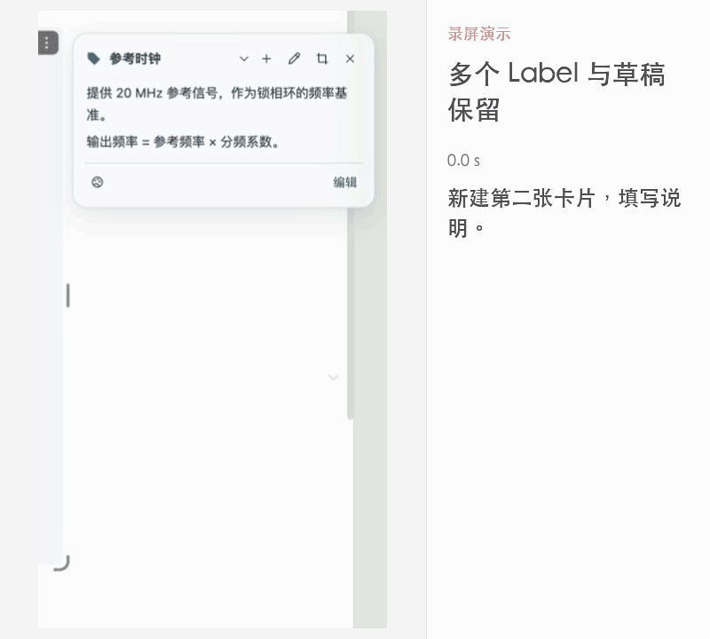
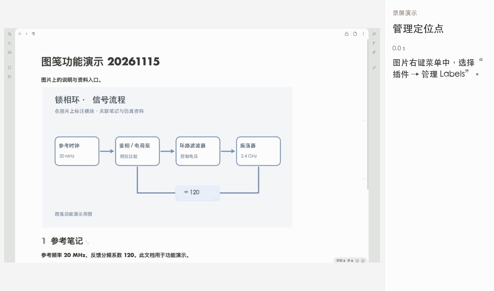
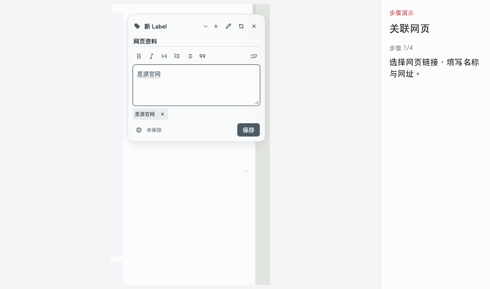
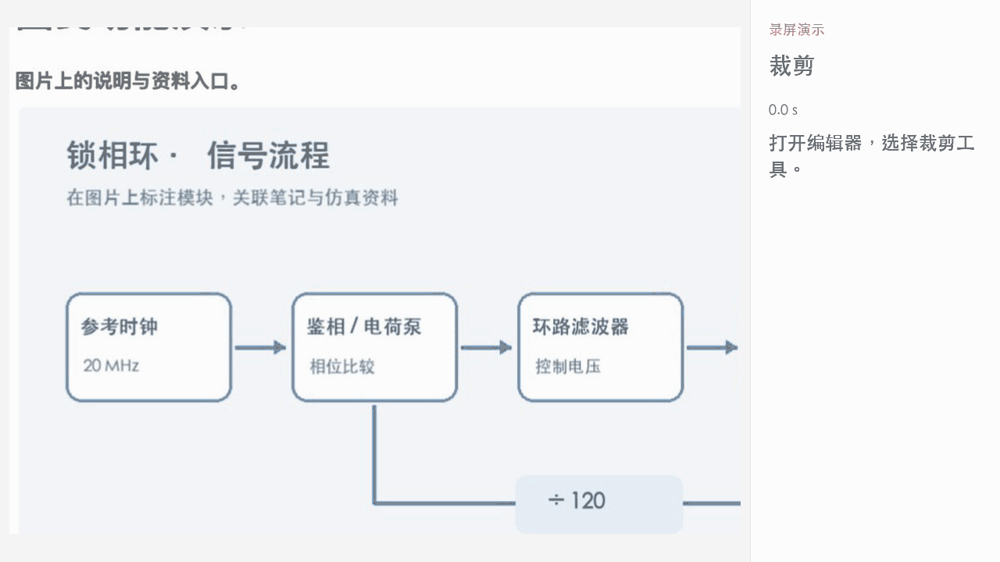
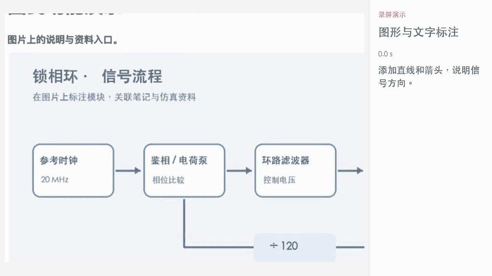
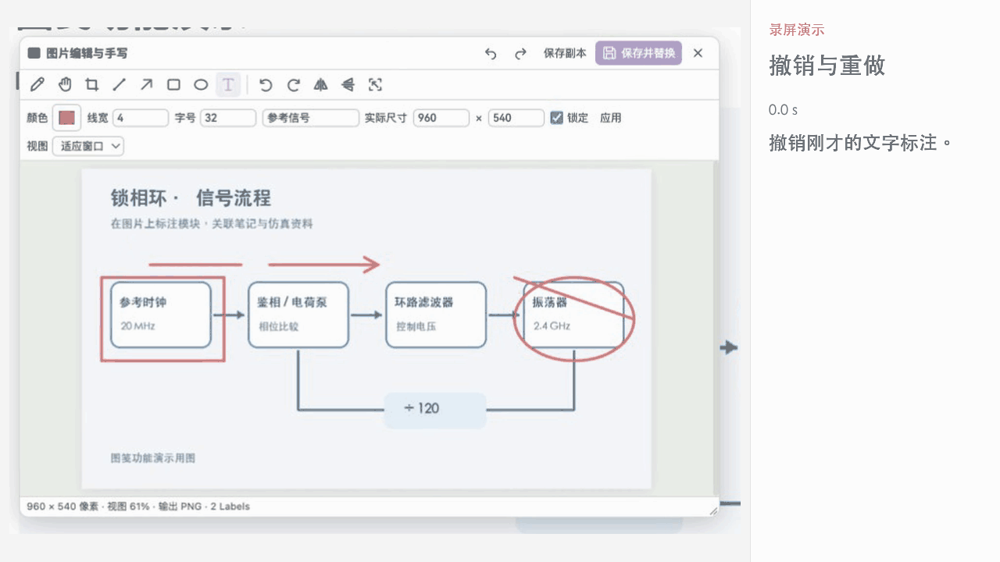
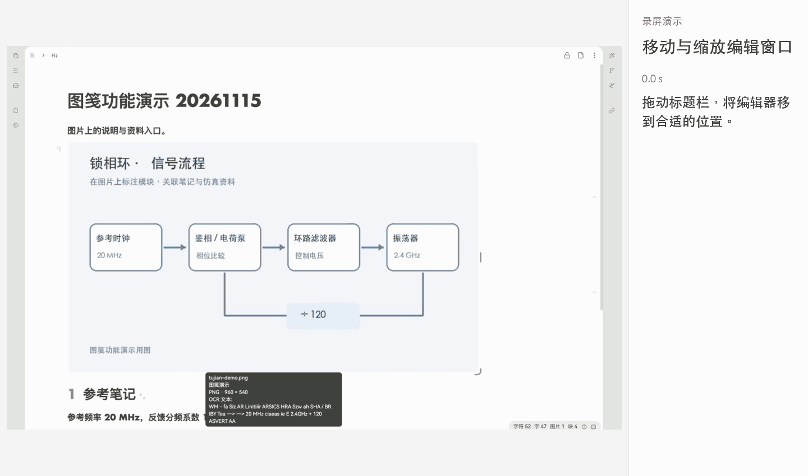
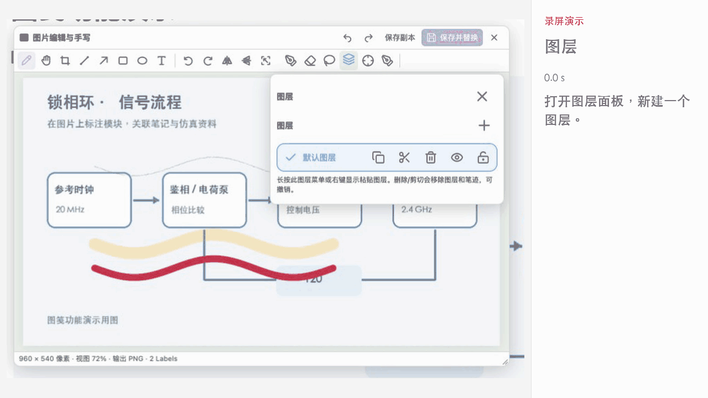
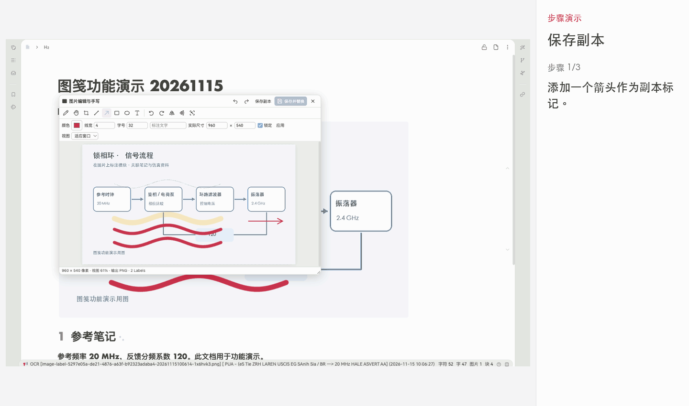
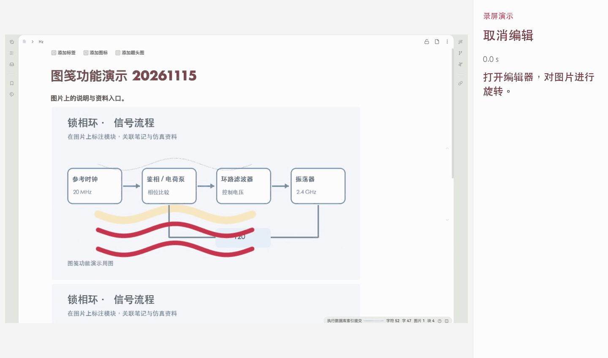

# 图笺 · 思源里的图片便签

**Kmind 等导图工具的好帮手。图画好了，给重点贴张便签。**

用 Kmind 等工具画好导图，把导出的图片插进思源正文，再用图笺给图上的分支补说明、挂资料。比如在「傅里叶变换」旁贴一张便签，链接到推导笔记；在「练习题」旁挂一份 PDF。复习时把鼠标移到图上，就能看到便签、点开资料。移开鼠标，图上依旧清清爽爽。

截图、流程图、课件也能这样用。想把截图多余的边裁掉，或在图上圈出一句重点，直接用图片左上角的工具。

[下载图笺（package.zip）](https://github.com/jiangeeeeee/siyuan-image-label/releases/latest/download/package.zip) · [安装步骤](#安装与使用)

## 图片旁边的两个工具

把鼠标移到正文图片上，左上角就会出现一排小工具：

- **编辑图片**：裁剪、旋转、调整尺寸，顺手加几个箭头或标记。
- **手写批注**：拿起手写笔，在图片上圈画、标注。

工具栏避开了思源原有的图片操作区，用完移开鼠标，图片就恢复清爽。

**精简悬浮工具栏**

移入图片后显示编辑、手写两个按钮；Label 卡片仍自动出现，无需额外开启。

## 给图上的重点贴便签

一张图片可以拥有多个 Label，每个 Label 都能放在你想要的位置。

鼠标移入图片，Label 便轻轻浮现；移开后自动隐藏。平时不会有一堆编号挡住图片，只有进入管理模式时，才会显示可拖动的定位点。

你可以：

- **随手添加**：在图片上选择位置，写下标题和说明。
- **原位编辑**：点击 Label 的编辑按钮，直接修改内容。
- **添加多个标签**：通过卡片顶部切换或新建 Label。
- **调整位置**：进入管理模式，拖动标签定位点。
- **保留草稿**：编辑时不小心移开鼠标，写过的内容也不会丢失。

Label 会根据屏幕空间调整位置，尽量待在图片旁边，不遮挡正在查看的内容。

动图：多张便签、定位与文字排版

**多个 Label 与草稿保留**

新建第二个 Label，移开鼠标后继续编辑草稿，再通过下拉列表切换。

**管理定位点**

在图片右键菜单中选择「插件 → 管理 Labels」，拖动定位点后结束管理。

### 像写笔记一样编辑 Label

不用记 Markdown 语法，选中文字后直接点击工具栏，就能设置加粗、斜体、标题、引用和列表。

也可以在正文中插入超链接，让说明文字和参考资料自然地排在一起。

**富文本排版**

选中文字后，依次展示加粗、斜体、标题、编号、列表和引用的效果。

## 从图上点开参考资料

假设你正在整理一张设备结构图，可以在不同零部件旁放置 Label，分别关联：

- **思源文档或内容块**：点击后直接跳转到对应笔记。
- **网页资料**：打开参考文献、教程或项目网站。
- **本地文件**：打开 MATLAB 仿真文件、PDF、Word、Excel 等。
- **本地文件夹**：直接进入对应的工程目录。
- **应用程序或快捷方式**：经过确认后，使用系统支持的方式打开。

比如给电路图上的 PLL 模块添加一个“仿真程序”标签，点击就能调用电脑上关联的 MATLAB 文件。

这些链接不需要直接写在图片上，图片仍然保持原来的样子。

本地文件使用当前设备的路径。换一台电脑时，可以为同一个 Label 重新绑定对应文件，不影响标签里的其他内容。

**关联思源文档**

搜索并关联思源文档，点击卡片中的链接跳转到参数说明。

动图：关联网页和本地资料

**关联网页**

填写网页名称和网址，保存后点击链接打开网页。

**绑定本地资料**

依次绑定本地文件、文件夹和应用程序。动图展示绑定过程；实际打开本地资料需使用思源桌面端。

## 在正文里裁图、画箭头

图笺内置了一套简洁的图片编辑工具，日常处理图片，不必再专门打开一款修图软件。

| 功能 | 可以做什么 |
|---|---|
| 裁剪 | 自由裁剪，或选择常用比例 |
| 旋转、翻转 | 调整图片方向 |
| 缩放查看 | 放大细节、拖动画布，不改变原图尺寸 |
| 调整尺寸 | 修改图片的实际宽度和高度 |
| 图形标注 | 添加直线、箭头、矩形、椭圆和文字 |
| 撤销、重做 | 随时调整刚才的操作 |

编辑窗口可以移动、缩放，不会一下子盖住整篇笔记。

支持 PNG、JPEG 和静态 WebP 图片，编辑结果保存为 PNG。

**裁剪**

选择裁剪比例，拖出保留范围，再确认裁剪。

动图：旋转、缩放、调整尺寸、标注与撤销

**旋转与翻转**

依次展示左右旋转、水平翻转和垂直翻转。

**缩放查看与平移**

展开尺寸设置后放大视图，用平移工具查看细节，再恢复适应窗口。

**调整图片尺寸**

锁定宽高比例，将图片从 960 × 540 调整为 720 × 405 像素。

**图形与文字标注**

用直线和箭头指示方向，用矩形、椭圆和文字补充说明。

**撤销与重做**

依次撤销文字和椭圆，再用重做恢复。

**移动与缩放编辑窗口**

拖动标题栏移动窗口，拖动右下角扩大编辑区域。

## 随手在图上写两笔

图笺集成了源生笔迹的手写工具，可以直接在图片上圈画，不会写到正文的其他位置。

提供四种笔刷，以及画笔颜色、粗细、橡皮擦、图层和激光笔工具。支持设备提供的压感，写起来更接近真实笔迹。

无论是给电路图标注信号流向、给数学题圈出关键条件，还是在截图上随手写几个字，都能直接完成。

**笔迹可以继续编辑。** 下次打开图片，还能修改之前写过的内容，不必从头再画。

**四种笔刷、颜色与粗细**

依次使用钢笔、铅笔、马克笔和彩笔，并调整颜色与粗细。以下为鼠标操作演示，压感效果取决于输入设备。

动图：橡皮擦、图层和激光笔

**橡皮擦**

选择「笔画擦除」，划过一条笔迹即可将其整条擦除。

**图层**

新建图层后书写，再隐藏、显示默认图层，分别查看两层内容。

**激光笔**

使用激光笔临时指示重点，松开后轨迹逐渐消失。

## 保存图片，下次接着改

编辑完成后，可以选择：

**保存替换**：更新正文中的当前图片引用，保留原始资源文件。

**另存副本**：将编辑后的图片作为新的独立图片块插入正文，原图继续保留。

图片编辑和手写操作共用撤销、重做记录，最多支持 50 步。取消编辑则不会改动正文。

Label 随所属正文块保存，可编辑笔迹数据保存在工作空间的插件目录中。备份或迁移笔记时，记得将图片资源与插件数据一同保留。

动图：替换图片、保存副本和取消编辑

**保存替换并继续编辑笔迹**

保存并替换后重新打开编辑器，已保存的笔迹仍可继续编辑。

**保存副本**

点击「保存副本」后，正文中同时保留原图片和带标记的独立副本。

**取消编辑**

旋转图片后点击取消，正文仍显示编辑前的图片。

## 换一张顺眼的便签

点击卡片底部的调色板，可以切换雾白、杏桃、苔绿和深海四套外观，也可以选淡入、轻移或舒展三种动画。图笺会遵循系统的「减少动态效果」设置。

动图：四套外观和三种动画

**四套卡片外观**

打开卡片底部的外观设置，依次切换雾白、杏桃、苔绿和深海。

**三种出场动画**

选择淡入、轻移或舒展后，移开鼠标，再次悬浮查看出场效果。

## 安装与使用

1. [下载 `package.zip`](https://github.com/jiangeeeeee/siyuan-image-label/releases/latest/download/package.zip)。
2. 解压后，将文件放入思源工作空间的 `data/plugins/siyuan-image-label/` 目录。
3. 确认 `plugin.json` 位于插件目录根部。
4. 打开思源，在插件管理中启用「图笺」。

启用后，把鼠标移到正文中的 PNG、JPEG 或静态 WebP 图片上，就能看到工具栏和便签。如果正在用「源生笔迹」给整篇正文手写，先切回箭头模式。Mermaid 等代码渲染的图需要先转成图片，再插入正文。

**当前版本：** v0.3.1  
**适用版本：** 思源笔记 3.8.5 及以上  
**主要平台：** Windows、macOS 桌面端

图片编辑与 Label 阅读也适用于受支持的桌面浏览器环境；调用电脑上的本地文件和程序则使用桌面端。

部分动图录制于 v0.3.0，画面里的工具栏有四个按钮。v0.3.1 的左上角只保留「编辑图片」和「在图上手写」，便签仍会自动出现。
