# 图笺

在思源里翻到一张 Kmind 导图，还记得某个分支很重要，却想不起当时把推导写在哪一页？把鼠标移到图上，写一句提醒，再把那篇笔记链接进来。下次读到这里，说明和资料就在图旁边。

**v0.3.4** · 思源笔记 **3.8.5 及以上** · 桌面客户端、桌面浏览器 · [下载安装包 package.zip](https://github.com/jiangeeeeee/siyuan-image-label/releases/download/v0.3.4/package.zip)

手动安装时，把压缩包解到工作空间的 `data/plugins/siyuan-image-label/`，让 `plugin.json` 直接位于这个目录下。在思源的插件管理中启用「图笺」，打开一篇带图的笔记，就可以试了。

## 🌟 本版新增

| 想做什么 | 从哪里开始 |
| --- | --- |
| 改完 PlantUML 图，还能读到原来的便签 | 鼠标移到图上，写好便签点「保存」，再用图块右上角的「编辑」修改图 |
| 截取温度曲线里最值得看的那一段 | 图片左上角「编辑图片」→「裁剪」→「保存并替换」 |
| 把截图缩到指定宽度，直接放回正文 | 「编辑图片」→「尺寸设置」→ 填写宽度 →「保存并替换」 |

### 流程图多了一步，原来的便签还在

例如，采集器把读数交给记录仪，你想提醒自己「收到回执后才开始下一轮采样」。鼠标移到思源渲染的 PlantUML 图上，写下提醒，点「保存」。

在同一个 PlantUML 块里点「编辑」，给记录仪补一条返回箭头。图重新渲染后，再把鼠标移上去，仍能读到那句话。便签跟着这个图块保存，关掉笔记再打开也能看到。

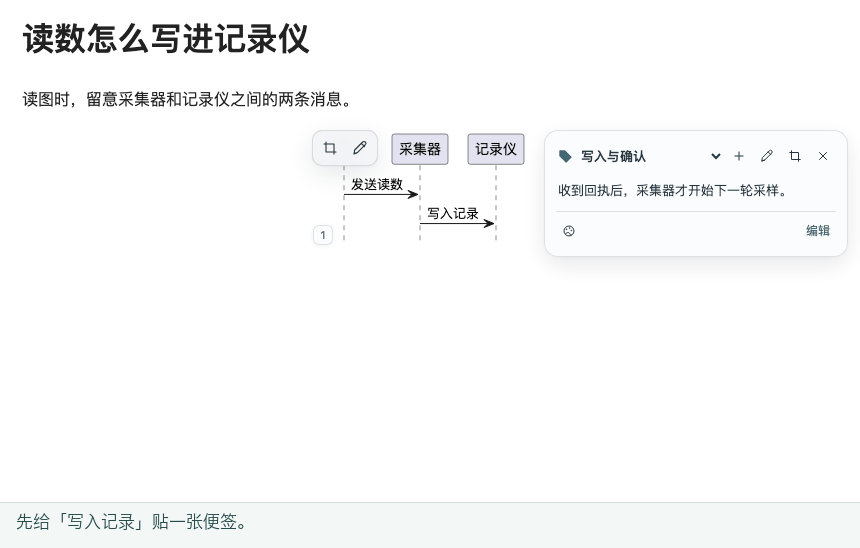

### 框住峰值，直接把这一段放回正文

一整张温度曲线里，你可能只想讨论峰值。把鼠标移到图片上，点左上角的「编辑图片」，选「裁剪」，拖出要保留的范围。这次可以从选框直接点「保存并替换」，回到正文，原位置就只显示选中的那一段。

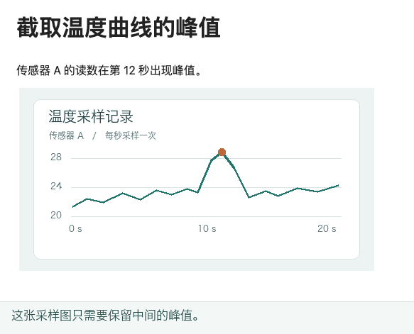

### 把图缩到 320 像素宽

同一张采样图放进复习提纲时，可以给它留少一点版面。点「编辑图片」里的「尺寸设置」，保持宽高比例锁定，把宽度从 500 改成 320，直接点「保存并替换」。正文里的图会随即变小，保存下来的图片也变成了 320 × 165 像素。

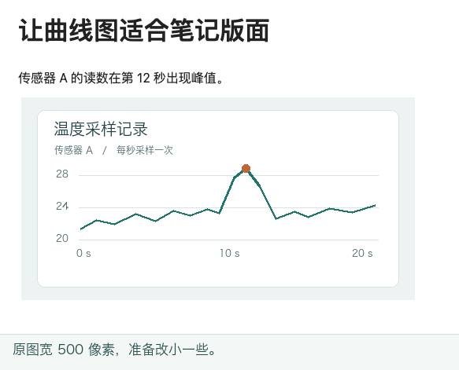

## ✍️ 其余功能

### 从第一张便签开始

找一张正文图片，把鼠标移上去。空便签会直接打开输入框，标题可以留空。写下说明，点「保存」。移开鼠标读正文，再移回来，看到的就是刚才写好的内容。想改一个字，点卡片右下角的「编辑」。

### 一张导图，给几个不同的位置分别写说明

点卡片顶部的加号「新建 Label」，就能再写一张便签。用顶部下拉框在便签之间切换，图的左下角会显示总数。要标出具体位置，右键图片，选「插件」里的「管理 Labels」，把编号拖到对应位置，再点「结束管理」。

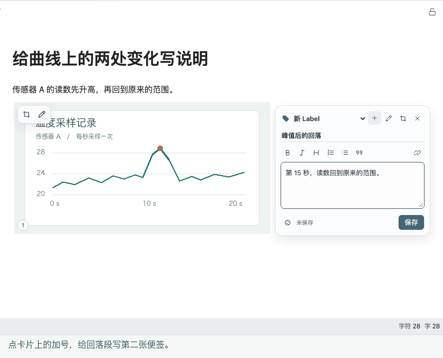

### 把带便签的图粘到另一篇笔记

在思源正文中复制或剪切图片，再粘贴到同一工作空间里的另一篇笔记。只要两处用的是同一个图片资源，便签内容、链接和位置就共用一份。在复习提纲里给图补一句说明，从课堂笔记打开这张图也能读到。

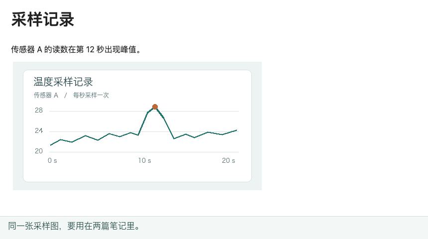

### 把几行说明排成清单

在卡片里点「编辑」，选中文字后，可以点「加粗」「倾斜」「标题」或「引用」。要写操作步骤，就一次选中几行，点「编号」；要列并列的条件，点「列表」。排好版再保存，图笺会把内容存成 Markdown。

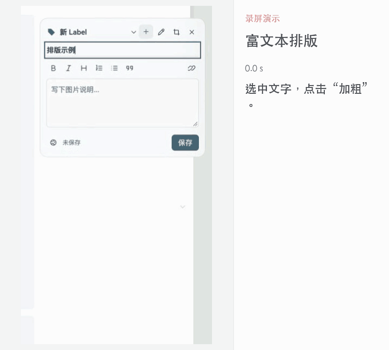

### 从图上的一个模块，跳到推导或实验资料

在编辑中的便签里点链条图标「插入链接」，选择「思源文档 / 块」。可以搜索笔记标题，也可以直接粘贴思源块链接。选好目标，点「插入链接」，保存便签。下次点卡片里的文字，就会跳到对应笔记。

网页用「网页 / 在线文档」，填入网址即可。电脑里的实验手册或工程目录则选「本地文件」或「本地文件夹」。本地路径按设备绑定，在思源桌面客户端中打开。

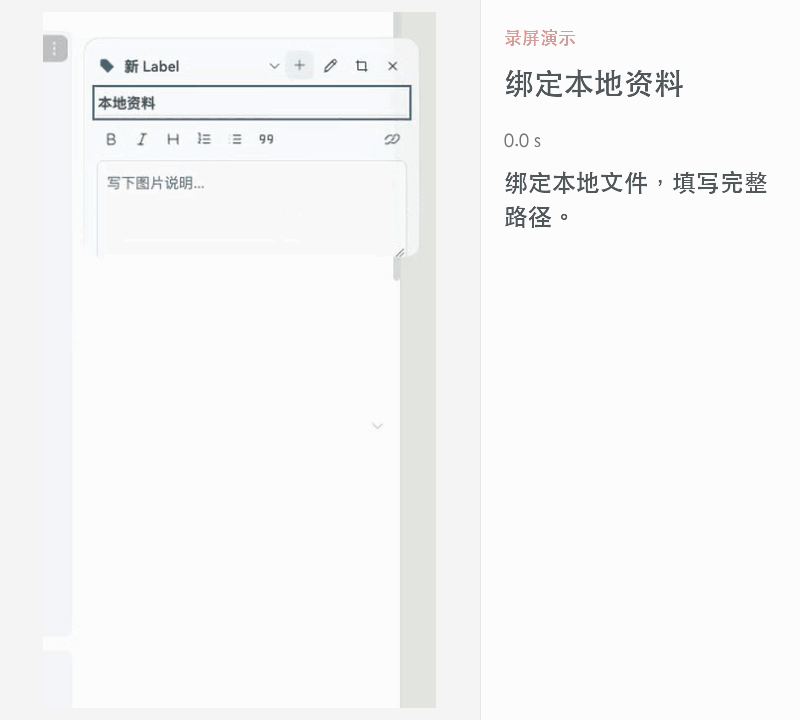

### 圈住一块电路，再画个箭头

打开「编辑图片」，用「矩形」或「椭圆」圈出模块，再用「箭头」标明信号方向。「直线」可以划重点，「文字」可以补参数。画错一笔，用窗口上方的「撤销」，也可以「重做」。

看细节时，怎样放大、平移或转正图片？

在「尺寸设置」里调高「视图」比例，选择「平移」拖到要看的位置。选回「适应窗口」，就能重新看到整张图。编辑窗口也可以拖动标题栏移动，或从右下角拉大。

遇到横竖颠倒的照片，点「左转90°」或「右转90°」。需要镜像时，选「水平翻转」或「垂直翻转」。

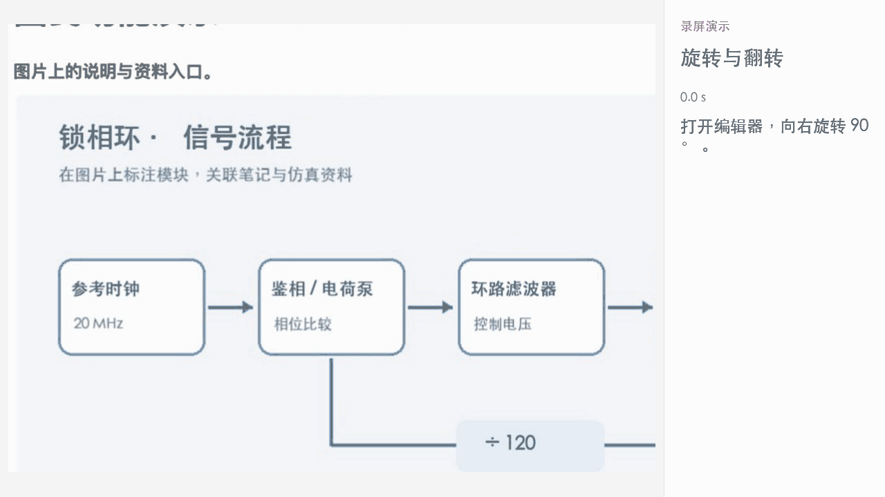

### 用自己的笔迹，在图上圈画

点图片左上角的「在图上手写」，就能用源生笔迹的钢笔、铅笔、马克笔或彩笔在图片范围内书写。比如先用马克笔划出信号通路，再换细一点的钢笔写参数。颜色和粗细都可以调，压感取决于输入设备。

擦掉一笔、分层书写，或用激光笔临时指示

想擦掉整条线，在橡皮工具里选「笔画擦除」，划过那条笔迹即可。

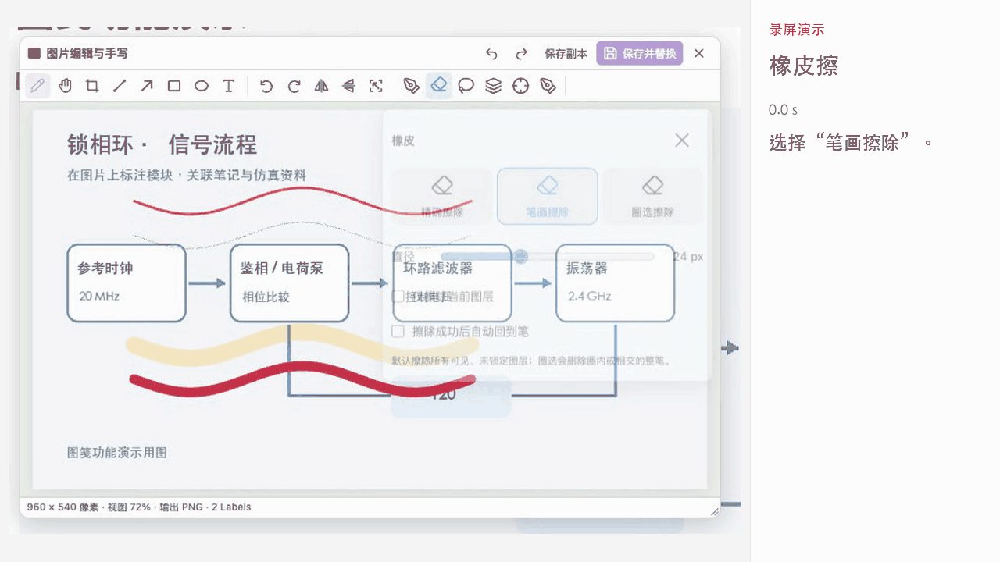

把讲解用的标记写在新图层里，就可以单独隐藏或显示这一层。

讲到哪儿就指到哪儿，可以用激光笔。松开后，指示轨迹会自行淡去。

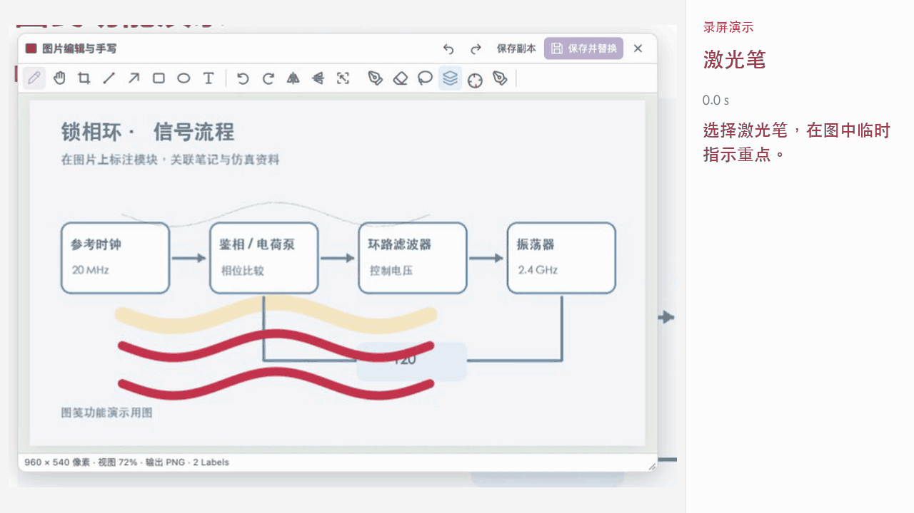

### 留一份原图，旁边放批注版

轻编辑支持 PNG、JPEG 和静态 WebP，编辑结果保存为 PNG。点「保存副本」，思源会在下方插入带标记的新图片块，两张图可以对照。想在原位置更新就点「保存并替换」，原资源文件会保留。下次用图笺重新打开批注图，还能接着改笔迹。

看一次保存后继续编辑笔迹的过程

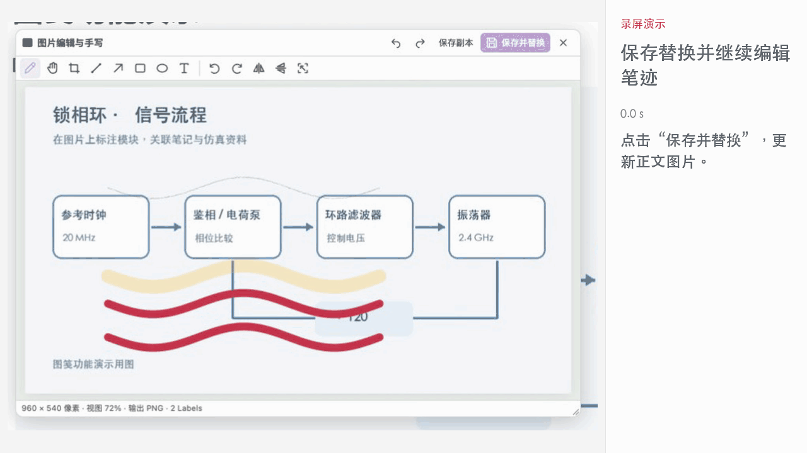

备份便签和可编辑笔迹时，一起保留图片资源、笔记和工作空间里的 `data/storage/petal/siyuan-image-label/` 目录。

### 给卡片换个颜色

点便签底部调色板「外观设置」，可以在雾白、杏桃、苔绿和深海之间切换。比如给浅色导图配一张苔绿的卡片，读说明时更容易和图上的白底区分开。

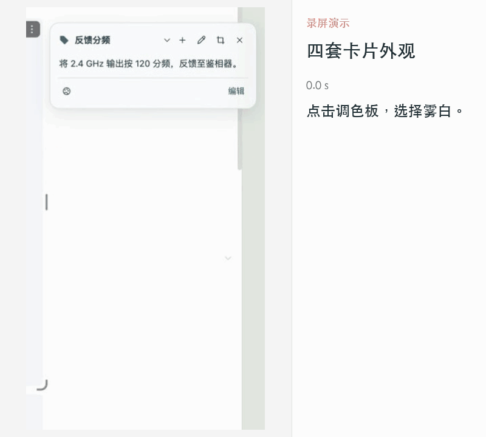

看看淡入、轻移和舒展三种出场动画

选好出场效果，把鼠标移开，再移回图上，就能看到卡片出现的方式。

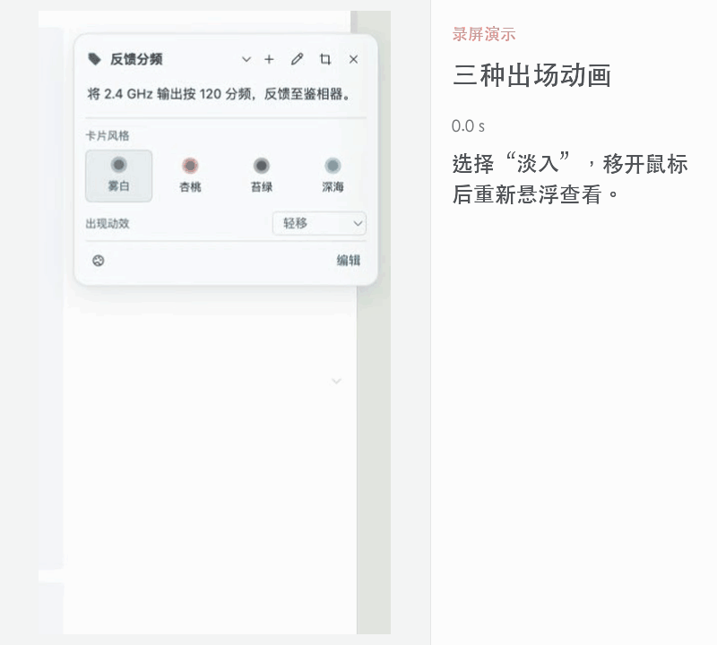

[项目许可证](LICENSE) · [第三方声明](THIRD_PARTY_NOTICES.md) · [源生笔迹组件许可](NATIVE_COMPONENT_LICENSE.txt) · [组件第三方声明](NATIVE_THIRD_PARTY_NOTICES.md) · [DOMPurify 许可](DOMPURIFY_LICENSE.txt)

## 🕰 版本记录

| 版本 | 主要更新 |
| --- | --- |
| [v0.3.4](https://github.com/jiangeeeeee/siyuan-image-label/releases/tag/v0.3.4) | 同一 PlantUML 块重编译后保留便签。拖好裁剪范围或填好新尺寸就能直接保存替换，正文立即显示结果。 |
| [v0.3.2](https://github.com/jiangeeeeee/siyuan-image-label/releases/tag/v0.3.2) | 复制、剪切或移动图片后，便签跟着走。同一工作空间里，同一图片的各处引用共用便签。 |
| [v0.3.1](https://github.com/jiangeeeeee/siyuan-image-label/releases/tag/v0.3.1) | 图片左上角精简为「编辑图片」和「在图上手写」两个按钮，移入图片即可打开便签。 |
| [v0.3.0](https://github.com/jiangeeeeee/siyuan-image-label/releases/tag/v0.3.0) | 可以给图片贴便签、排版和插入链接，也能裁图、手写并继续编辑笔迹。提供四种卡片外观和三种出场动画。 |
