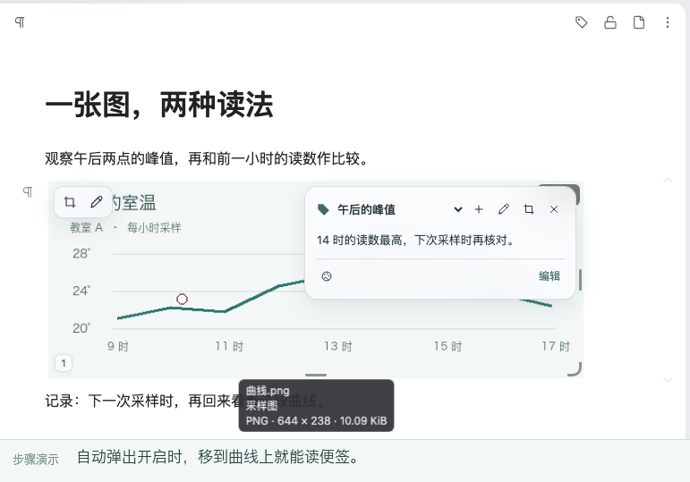
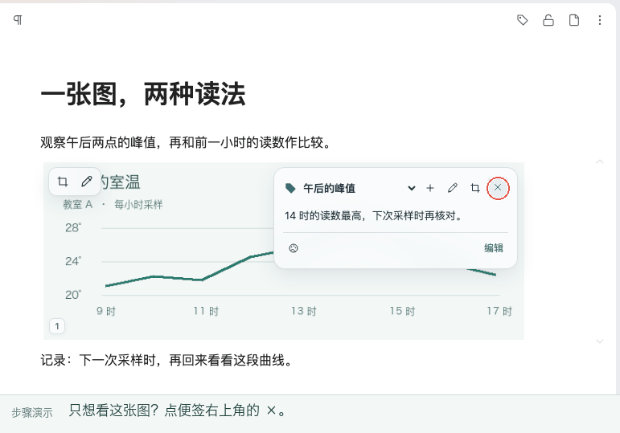
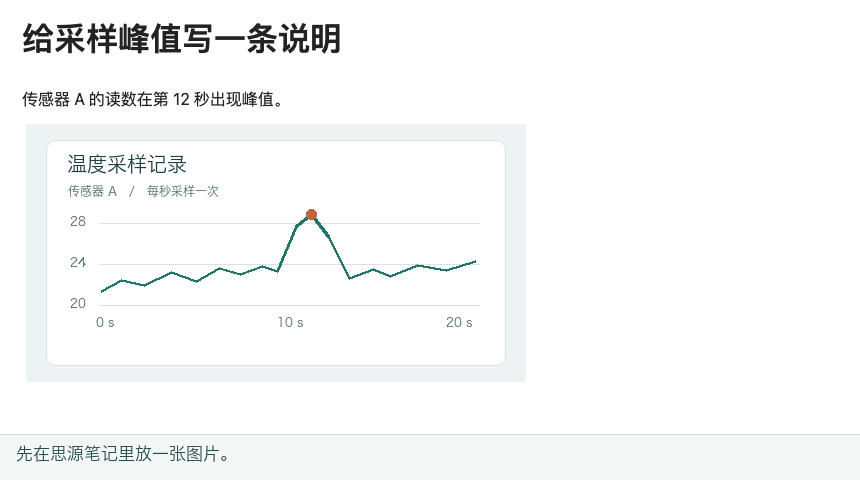
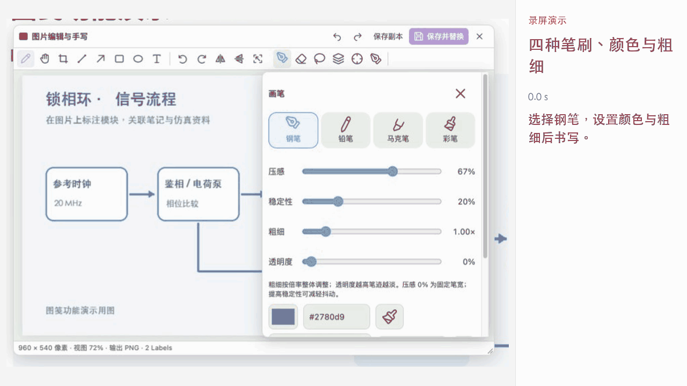

# 图笺

给思源里的图片贴便签。把 Kmind 导图放进笔记，给一个分支补上推导链接，或者直接在图上圈两笔。下次把鼠标移到图上，说明和资料都在手边。

**v0.3.5** · 思源笔记 **3.8.5 及以上** · 桌面客户端、桌面浏览器 · [下载安装包](https://github.com/jiangeeeeee/siyuan-image-label/releases/download/v0.3.5/package.zip)

## 🌟 本版新增

| 想做什么 | 怎么做 | 会看到什么 |
| --- | --- | --- |
| 这会儿只想读笔记 | 点文档顶部面包屑里的标签图标「图笺：暂停自动弹出」 | 图标添上一道斜线。经过任何图片，便签和图笺工具栏都收起来。再点一次即可恢复，重新打开思源也会记住上次的选择。 |
| 只想看清眼前这张图 | 点这张便签右上角的 × | 指针在图内移动，便签一直收着。移出图片再移回来，就能重新读到它。其他图片照常。 |

**暂停所有图片的自动弹出。** 暂停期间如果临时想画个箭头，仍可右键图片，从「插件」菜单打开编辑器。

**只收起眼前这张便签。** 比如便签正好盖住曲线的峰值，点 × 就能看完整条曲线。

## ✍️ 已有功能

### 把说明和资料放到图旁边

第一次用，可以先找一张截图，把鼠标移上去，写一句提醒，点「保存」。再移回来，看到的就是刚写好的说明。

| 想做什么 | 怎么做 | 看操作 |
| --- | --- | --- |
| 给导图的几个分支分别写说明 | 点卡片顶部的「新建 Label」，用下拉框切换。右键图片，选「插件 → 管理 Labels」，就能拖动编号调整位置。 | [多张便签与定位](docs/demos/positions.gif) |
| 把图放进另一篇笔记 | 在同一工作空间里复制或剪切图片，再粘贴到目标位置。只要引用同一张图片，便签、链接和位置就会跟过去。 | [跨笔记复制](docs/demos/carry.gif) |
| 把几行字排成步骤 | 点「编辑」，选中几行文字，再点「编号」或「列表」。加粗、倾斜、标题和引用也能直接点选，保存时会保留 Markdown 排版。 | [排版便签](docs/demos/rich-text.gif) |
| 从图上的模块跳到推导笔记 | 点「插入链接」，搜索思源文档标题或粘贴块链接。也可以填网页地址，或在桌面客户端绑定电脑上的文件和文件夹。 | [链接思源文档](docs/demos/siyuan-links.gif) · [绑定本地资料](docs/demos/local-links.gif) |
| 改完 PlantUML 图，接着看原来的说明 | 给思源渲染的 PlantUML 图写好便签，再编辑同一个代码块。图重新渲染后，便签仍在。 | [改图后读便签](docs/demos/plantuml.gif) |
| 给便签换个颜色 | 点卡片底部的「外观设置」，选四种配色中的一种，也可以换成淡入、轻移或舒展。 | [卡片配色](docs/demos/themes.gif) · [出场动画](docs/demos/animations.gif) |

### 裁图、画箭头，或者直接手写

鼠标移到图上，左上角有两个入口。「编辑图片」适合裁图和画形状，「在图上手写」会直接打开画笔。轻编辑支持 PNG、JPEG 和静态 WebP，保存的图片为 PNG。

| 想做什么 | 怎么做 | 看操作 |
| --- | --- | --- |
| 只留截图里有用的那一段 | 点「编辑图片 → 裁剪」，拖出范围，直接点「保存并替换」。正文原位置会显示裁好的图。 | [截取曲线峰值](docs/demos/crop.gif) |
| 把图改小，或放大看一个细节 | 在「尺寸设置」里改宽度并保存，就能改变图片的实际大小。只想看细节，调高「视图」比例，再用「平移」拖动画布。 | [改实际尺寸](docs/demos/resize.gif) · [放大查看](docs/demos/zoom-pan.gif) |
| 转正照片，标出信号方向 | 用旋转或翻转工具调整方向，再用矩形、椭圆、直线、箭头或文字标出重点。画错了可以撤销、重做。 | [旋转与翻转](docs/demos/rotate-flip.gif) · [图形与文字](docs/demos/shapes.gif) |
| 在图上写几个字 | 点「在图上手写」，从钢笔、铅笔、马克笔和彩笔中选一支，调好颜色和粗细就能写。 | [四种笔刷](docs/demos/brushes.gif) |
| 隐藏讲解用的笔迹 | 把讲解内容写在单独的图层里，随时切换显示。要擦掉一整笔，选「笔画擦除」；只想临时指给人看，就用激光笔。 | [图层](docs/demos/layers.gif) · [橡皮](docs/demos/eraser.gif) · [激光笔](docs/demos/laser.gif) |
| 并排看看原图和批注图 | 点「保存副本」，带标记的新图就会插在原图下方。点「保存并替换」则更新正文里的当前图片，再打开还能接着改笔迹。 | [保存副本](docs/demos/save-copy.gif) · [继续改笔迹](docs/demos/reedit.gif) |

**手动安装**　解压安装包，把文件放进工作空间的 `data/plugins/siyuan-image-label/`，确认 `plugin.json` 就在这个目录下，然后到思源的插件管理中启用「图笺」。

**备份便签和笔迹**　一起保留笔记、图片资源和工作空间里的 `data/storage/petal/siyuan-image-label/` 目录。

[项目许可证](LICENSE) · [第三方声明](THIRD_PARTY_NOTICES.md) · [源生笔迹组件许可](NATIVE_COMPONENT_LICENSE.txt) · [组件第三方声明](NATIVE_THIRD_PARTY_NOTICES.md) · [DOMPurify 许可](DOMPURIFY_LICENSE.txt)

## 🕰 版本记录

| 版本 | 主要更新 |
| --- | --- |
| [v0.3.5](https://github.com/jiangeeeeee/siyuan-image-label/releases/tag/v0.3.5) | 面包屑增加自动弹出开关。点 × 收起单张便签后，指针移出图片再移回才会重新显示。 |
| [v0.3.4](https://github.com/jiangeeeeee/siyuan-image-label/releases/tag/v0.3.4) | 同一 PlantUML 块重新渲染后保留便签。裁剪和改尺寸后可以直接保存替换，正文随即更新。 |
| [v0.3.2](https://github.com/jiangeeeeee/siyuan-image-label/releases/tag/v0.3.2) | 复制或剪切图片时，便签会跟过去。同一工作空间内，同一图片的各处引用共用便签。 |
| [v0.3.1](https://github.com/jiangeeeeee/siyuan-image-label/releases/tag/v0.3.1) | 图片左上角只保留「编辑图片」和「在图上手写」，移入图片即可打开便签。 |
| [v0.3.0](https://github.com/jiangeeeeee/siyuan-image-label/releases/tag/v0.3.0) | 图片便签支持排版和链接，可以裁图、手写并继续编辑笔迹。加入四种卡片配色和三种出场动画。 |
